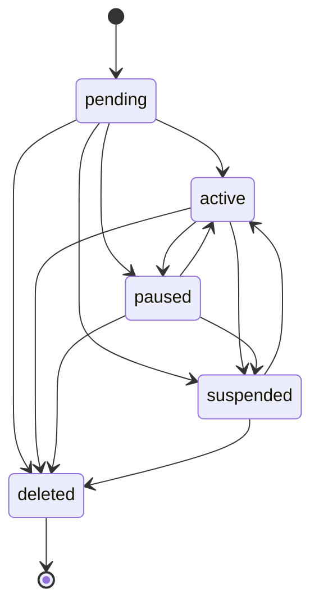
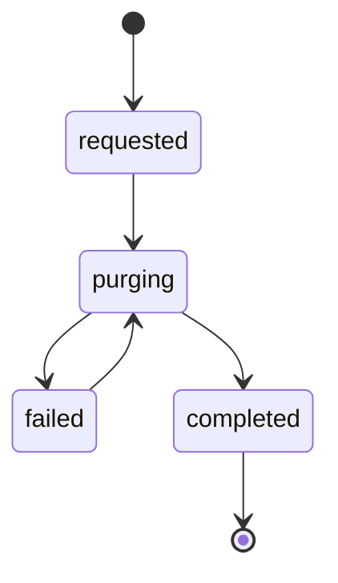
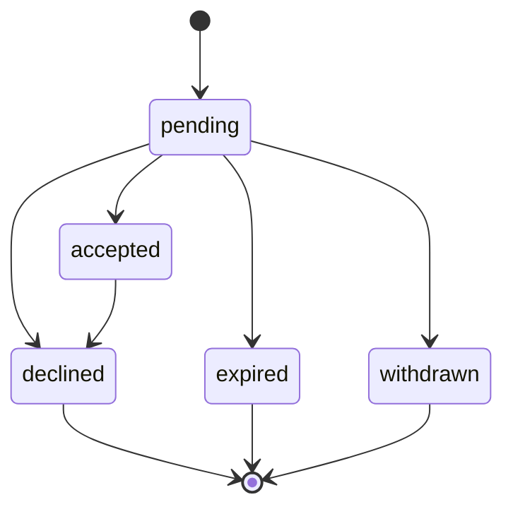
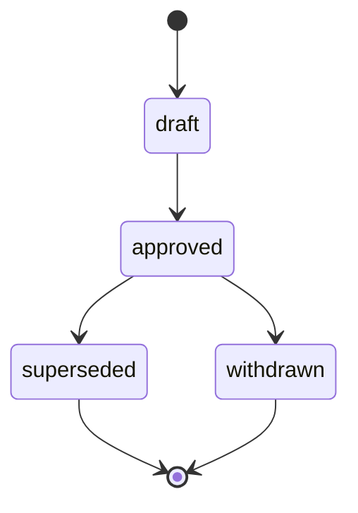
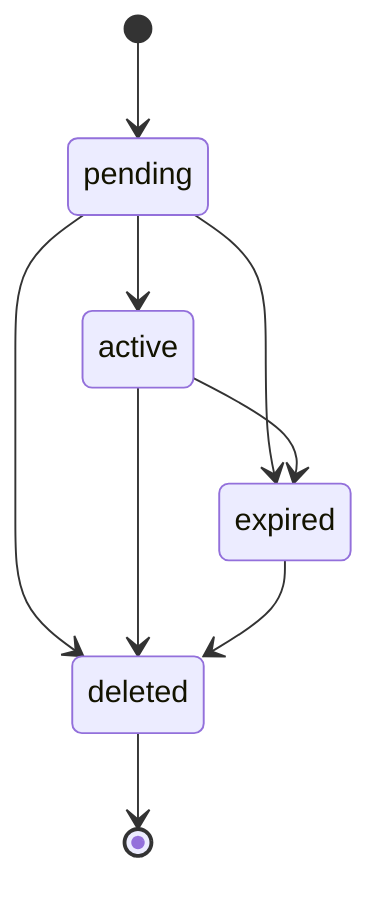
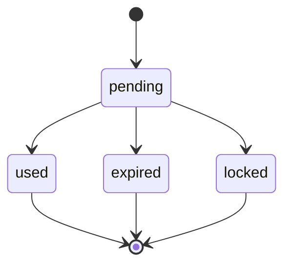
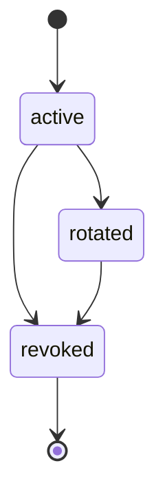
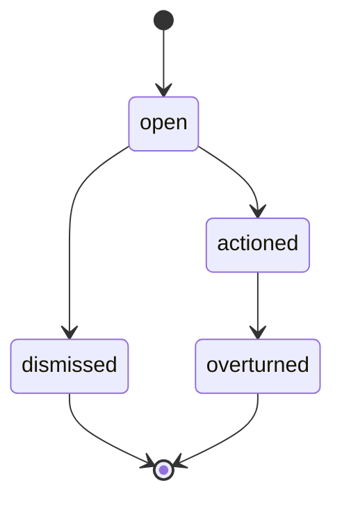

# State machines

Every status in 不期 that changes over time, where its rules live, and what enforces them. Read
this before writing code that changes a status. The lifecycle diagrams below are generated from
the code (`npm run docs:state-machines`). A test fails if they drift from the code, so they are
always the rules the code and the database actually enforce.

## The rule

A status only moves along declared edges, and those edges are declared once:

| Kind of status                                   | Declared as                                                                                           | Enforced by                                                                                       |
| ------------------------------------------------ | ----------------------------------------------------------------------------------------------------- | ------------------------------------------------------------------------------------------------- |
| A date: many events, actors and per-person facts | the event machine in `packages/domain/src/date/` (`transition`)                                       | the machine, plus the optimistic `revision` lock in every write                                   |
| A row's simple status                            | a lifecycle (`defineLifecycle` in `packages/domain/src/lifecycle.ts`), next to the logic that owns it | `assertCan` in code, and `app.guard_transition` in the database for every write, whoever makes it |
| A screen's flow in the app                       | a pure reducer in `apps/mobile/src/shell/`                                                            | the reducer: screens only send events                                                             |

A database refusal is SQLSTATE `23514` (`check_violation`), with the message
`<table>.<column>: <from> → <to> is not an allowed move`. Staying in the same state is never
refused. Inserts are not guarded, so fixtures and seeds can create a row in any state.

## The date (event machine)

`app.dates.status`, by `transition(date, event, actor)` in `packages/domain/src/date/machine.ts`.

- **Main path:** `DRAFT` → `ELIGIBLE` → `INVITED` → `BOTH_ACCEPTED` → `PAYMENT_PENDING` → `BOTH_PAID` →
  `VENUE_RESERVED` → `CONFIRMED` → `CHECKIN_PARTIAL` → `BOTH_CHECKED_IN` → `REVEALED` → `COMPLETED`
  → `POST_DATE_FEEDBACK` → `CLOSED`.
- **Side states:** `EXPIRED`, `CANCELLED_BEFORE_PAYMENT`, `CANCELLED_REFUND_PENDING`,
  `NO_SHOW_UNDER_REVIEW`, `SAFETY_HOLD`, `VENUE_UNAVAILABLE`, `PARTIAL_REFUND`, `DISPUTED`.
- **Who may send what:** `mayDispatch`.
- **Coverage:** every legal and illegal step is covered by `machine.test.ts` and its property tests.
- **Ownership:** owner review (CODEOWNERS). The database does not yet refuse an illegal status
  write on `app.dates`. Doing that needs the machine's reachable edges exported from
  `packages/domain`, which is left to the owner.

## Lifecycles (generated)

<!-- generated:lifecycles:start -->

### `app.users.status`

Declared in `packages/identity/src/account.ts`; the database enforces it with `app.guard_transition`.
Starts as `pending`; final: `deleted`.

### `app.account_deletion_requests.status`

Declared in `packages/privacy/src/lifecycle.ts`; the database enforces it with `app.guard_transition`.
Starts as `requested`; final: `completed`.

### `app.date_invites.status`

Declared in `packages/invitations/src/lifecycle.ts`; the database enforces it with `app.guard_transition`.
Starts as `pending`; final: `declined`, `expired`, `withdrawn`.

### `app.profile_versions.approval_state`

Declared in `packages/profile/src/lifecycle.ts`; the database enforces it with `app.guard_transition`.
Starts as `draft`; final: `superseded`, `withdrawn`.

### `app.media_assets.status`

Declared in `packages/media/src/lifecycle.ts`; the database enforces it with `app.guard_transition`.
Starts as `pending`; final: `deleted`.

### `app.auth_challenges.status`

Declared in `packages/auth/src/lifecycle.ts`; the database enforces it with `app.guard_transition`.
Starts as `pending`; final: `used`, `expired`, `locked`.

### `app.auth_sessions.status`

Declared in `packages/auth/src/lifecycle.ts`; the database enforces it with `app.guard_transition`.
Starts as `active`; final: `revoked`.

### `app.safety_reports.status`

Declared in `packages/safety/src/reports.ts`; the database enforces it with `app.guard_transition`.
Starts as `open`; final: `dismissed`, `overturned`.

<!-- generated:lifecycles:end -->

## In the app

- **Shell** (`apps/mobile/src/shell/state.ts`): `signed_out` → `notification_primer` (only while
  the system would still show its prompt) → `main` (with the selected tab) → `signed_out`.
- **Sign-in** (`apps/mobile/src/shell/sign-in.ts`): the `phone` step, then the `code` step, then
  `signed_in`, which is final. What is in flight is `sending`, `verifying` or nothing.
  - Every request carries its attempt number. A late result for any other attempt changes
    nothing, so a late answer can never pull the person back to a step they left (for example,
    after "修改").
  - The resend countdown is part of the state; `canSend` says when a request may start.
- **Home data** (`apps/mobile/src/App.tsx`, `useHome`): `loading` → `ready` | `failed`, and
  `failed` → `loading` on retry.

## Between the agents

The **A2A negotiation** (`packages/a2a-protocol/src/negotiation.ts`, `step`): a pure reducer over messages,
model calls and clock ticks. At most three questions per side, one at a time; a side proposes
once; both proposals decide the verdict; time or model calls running out is `NO_DECISION`.
A refused event leaves the state unchanged and names why.

## Derived, not stored

These are computed from other state each time and have no transitions of their own:

- **What a person sees of an invitation** (`invitationView`): `awaiting_you`, `accepted`,
  `confirmed`, `declined` or `closed`, from the date and their invitation.
- **Identity eligibility** (`eligibility`): from the attestations and the clock.
- **A person's recall entry:** present or absent, rebuilt by `refresh()`.
- **A consent grant:** live until `revoked_at` is set; a revocation is a new fact, never undone.

## Declared in the schema, not yet driven

These columns have a `CHECK` list but no code changes them yet. Whoever first writes one declares
its lifecycle and adds it to the guard in the same change:

- `app.venues.status`
- `app.venue_slots.status`
- `app.negotiations.status`: its lifecycle is already declared as `NEGOTIATION_LIFECYCLE`
  (`packages/a2a-protocol/src/negotiation.ts`; `RUNNING` → `PASS` | `REJECT` | `NEEDS_USER_CLARIFICATION`
  | `NO_DECISION`, all final; a retry is a new attempt row). The negotiation worker (ser-p03-05)
  adds its guard.
- `app.payment_orders.state`
- `app.refunds.state`

## Adding a status that changes

1. Declare it with `defineLifecycle` next to the logic that owns it. The type makes you list every
   state, and loading it fails on an unknown or unreachable state.
2. In code, call `assertCan(from, to)` before writing, or write with `WHERE status = '<from>'`.
3. Add its edges to `app.guard_transition` in a migration (`'from>to'` arguments), and its table
   to `lifecycle-guards.db.test.ts`, which tries every pair of states.
4. Add it to `LIFECYCLES` in `packages/db/src/state-machines.ts` and run
   `npm run docs:state-machines`.
