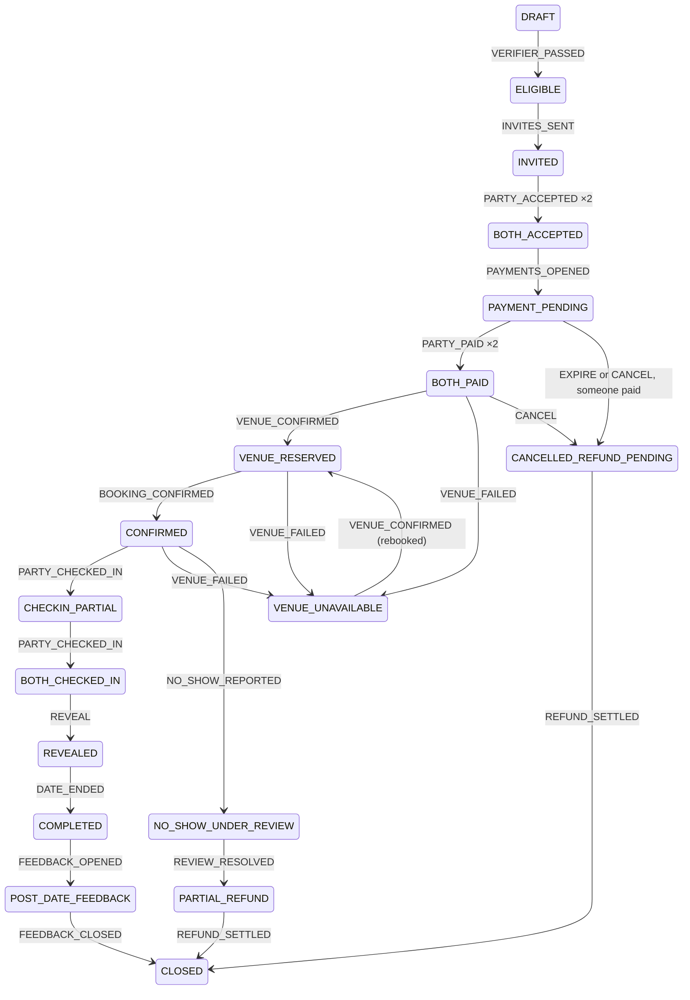

# @serendipity/domain

The deterministic kernel: state machines and invariants, with no I/O, no clock and no randomness.
Payment, booking and relationship rules are decided here and only here; models propose, this
package decides (ARCH-001 ADR-003). Changes need owner review (`.github/CODEOWNERS`).

- `assertNever(value)` ends every `switch` over a union, so a new state or event fails to compile
  until every switch handles it.
- `Brand<T, Name>` makes nominal identifiers, so a `UserId` is never passed as a `DateId`.
- The date state machine (`ser-p04-01`), below.

## The date state machine

`transition(date, event, actor)` is the only way a date changes. It is pure: it returns a new
record or an error, never throws, never mutates its input. A record is plain JSON with a
`machineVersion` (records of another version are refused) and a `revision` that increments on
every change, for optimistic locking when it is stored.

```ts
import { createDate, transition } from "@serendipity/domain";

const result = transition(
  createDate(),
  { type: "VERIFIER_PASSED" },
  { kind: "system", source: "verifier" },
);
if (result.ok) save(result.date, { expectedRevision: result.date.revision - 1 });
else log(result.error.code); // MACHINE_VERSION_MISMATCH | FORBIDDEN_ACTOR | ILLEGAL_TRANSITION | GUARD_FAILED
```

Besides the state, a record keeps per-person facts: who accepted, whether payment orders exist,
who paid, whether the venue holds the slot, who checked in, and where a safety hold came from.
Because the facts are per person, a repeated fact (a duplicate payment callback, a double tap at
check-in) returns `changed: false` instead of counting twice.

### States (ARCH-001 §8.1)

Main path: `DRAFT → ELIGIBLE → INVITED → BOTH_ACCEPTED → PAYMENT_PENDING → BOTH_PAID →
VENUE_RESERVED → CONFIRMED → CHECKIN_PARTIAL → BOTH_CHECKED_IN → REVEALED → COMPLETED →
POST_DATE_FEEDBACK → CLOSED`.

Side states: `EXPIRED`, `CANCELLED_BEFORE_PAYMENT`, `CANCELLED_REFUND_PENDING`,
`NO_SHOW_UNDER_REVIEW`, `SAFETY_HOLD`, `VENUE_UNAVAILABLE`, `PARTIAL_REFUND`, `DISPUTED`.



The diagram shows the main path and the main money paths; the table below is complete.

### Events, who may send them, and what they do

| Event                                                     | Sent by                          | Valid in → next state                                                                                                                                                                                                                |
| --------------------------------------------------------- | -------------------------------- | ------------------------------------------------------------------------------------------------------------------------------------------------------------------------------------------------------------------------------------ |
| `VERIFIER_PASSED` / `VERIFIER_REJECTED`                   | system: verifier                 | `DRAFT` → `ELIGIBLE` / `CANCELLED_BEFORE_PAYMENT`                                                                                                                                                                                    |
| `INVITES_SENT`                                            | system: booking                  | `ELIGIBLE` → `INVITED`                                                                                                                                                                                                               |
| `PARTY_ACCEPTED {party}`                                  | that person only                 | `INVITED` → `INVITED`, or `BOTH_ACCEPTED` once both have; a repeat is a no-op                                                                                                                                                        |
| `PAYMENTS_OPENED`                                         | system: booking                  | `BOTH_ACCEPTED` → `PAYMENT_PENDING`                                                                                                                                                                                                  |
| `PARTY_PAID {party}`                                      | system: payments                 | `PAYMENT_PENDING` → itself, or `BOTH_PAID` once both have; after expiry, cancellation or closing → `CANCELLED_REFUND_PENDING`; during a refund, dispute or hold → recorded; refused before payment orders exist; a repeat is a no-op |
| `VENUE_CONFIRMED`                                         | merchant, ops                    | `BOTH_PAID`, `VENUE_UNAVAILABLE` → `VENUE_RESERVED` (both must have paid)                                                                                                                                                            |
| `VENUE_FAILED`                                            | merchant, ops, booking           | `BOTH_PAID`, `VENUE_RESERVED`, `CONFIRMED` → `VENUE_UNAVAILABLE`                                                                                                                                                                     |
| `BOOKING_CONFIRMED`                                       | system: booking                  | `VENUE_RESERVED` → `CONFIRMED` (both paid **and** the venue holds the slot)                                                                                                                                                          |
| `PARTY_CHECKED_IN {party}`                                | merchant, ops                    | `CONFIRMED` → `CHECKIN_PARTIAL` → `BOTH_CHECKED_IN`; a repeat is a no-op                                                                                                                                                             |
| `REVEAL`                                                  | merchant, ops                    | `BOTH_CHECKED_IN` → `REVEALED` (both checked in)                                                                                                                                                                                     |
| `DATE_ENDED`                                              | merchant, ops, scheduler         | `REVEALED` → `COMPLETED`                                                                                                                                                                                                             |
| `FEEDBACK_OPENED` / `FEEDBACK_CLOSED`                     | system: scheduler                | `COMPLETED` → `POST_DATE_FEEDBACK` → `CLOSED`                                                                                                                                                                                        |
| `EXPIRE`                                                  | system: scheduler                | `ELIGIBLE` to `BOTH_ACCEPTED` → `EXPIRED`; `PAYMENT_PENDING` → `EXPIRED`, or `CANCELLED_REFUND_PENDING` if someone paid                                                                                                              |
| `CANCEL`                                                  | either person, ops, safety, risk | before anyone paid → `CANCELLED_BEFORE_PAYMENT`; once someone paid, until the reveal → `CANCELLED_REFUND_PENDING`                                                                                                                    |
| `NO_SHOW_REPORTED`                                        | merchant, ops, scheduler         | `CONFIRMED`, `CHECKIN_PARTIAL` → `NO_SHOW_UNDER_REVIEW`                                                                                                                                                                              |
| `SAFETY_HOLD_PLACED`                                      | safety, risk                     | any non-terminal state from `PAYMENT_PENDING` on → `SAFETY_HOLD`, remembering where from                                                                                                                                             |
| `SAFETY_RESOLVED {resume, cancel, partial_refund, close}` | safety                           | `SAFETY_HOLD` → where it came from / a cancellation / `PARTIAL_REFUND` / `CLOSED`                                                                                                                                                    |
| `REVIEW_RESOLVED {refund, partial_refund, no_refund}`     | ops                              | `NO_SHOW_UNDER_REVIEW` → `CANCELLED_REFUND_PENDING` / `PARTIAL_REFUND` / `CLOSED`                                                                                                                                                    |
| `DISPUTE_OPENED`                                          | either person, ops, payments     | any state where someone paid, except a hold or a dispute → `DISPUTED`                                                                                                                                                                |
| `DISPUTE_RESOLVED {refund, partial_refund, no_refund}`    | ops                              | `DISPUTED` → `CANCELLED_REFUND_PENDING` / `PARTIAL_REFUND` / `CLOSED`                                                                                                                                                                |
| `REFUND_SETTLED`                                          | system: payments                 | `CANCELLED_REFUND_PENDING`, `PARTIAL_REFUND` → `CLOSED`                                                                                                                                                                              |

No event accepts an agent: models propose, people and verified systems decide (ARCH-001 §10.3).
Refund **amounts** are not decided here; `ser-p04-07` applies the cancellation and no-show rules.

### Invariants the tests hold the machine to

- `CONFIRMED` and every later main-path state have both payments and a venue that holds the slot.
- `REVEALED` and later have both check-ins; one person's check-in reveals nothing.
- Money never ends in `EXPIRED` or `CANCELLED_BEFORE_PAYMENT`: a payment that arrives late (a
  gateway timeout that still charged, a late callback) moves the date to `CANCELLED_REFUND_PENDING`.
- A duplicate payment, acceptance or check-in changes nothing.
- A safety hold always records its origin, and resuming returns there (to `BOTH_PAID` if the second
  payment arrived during the hold).

`src/date/test-spec.ts` is the expected outcome of every event in a reachable record of every
state; `machine.property.test.ts` drives random event sequences from each of them with fast-check.
